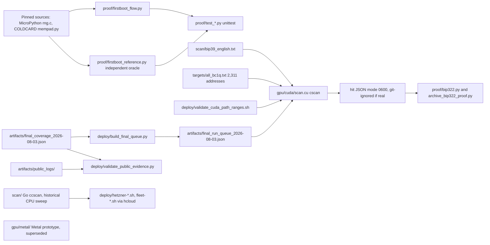
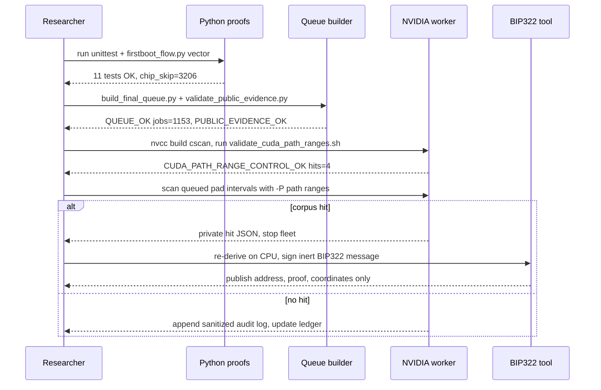

# COLDCARD Mk3 fallback-RNG recovery research

Reproducible research into whether the predictable MicroPython fallback RNG on vulnerable COLDCARD Mk3 firmware can recover any address in a public on-chain corpus.
It ships CPU reference models, a CUDA scanner, a strict coverage ledger and sanitized evidence logs.
It is for Bitcoin security researchers who want to verify or extend the negative result.

## Logs

- [CHANGELOG.md](CHANGELOG.md): release notes per commit, newest first.
- [PROMPTLOG.md](PROMPTLOG.md): owner instructions that shaped this repo.

## Status

| Field | Value |
|---|---|
| Version | v0.1.0 |
| Date | 2026-10-14 |
| Updated by | hermes-agent for emino |
| Default branch | `master` |
| Default-branch HEAD | `f30e679` |
| Deployment | not documented in repo as a service. GPU/CPU runs are ad hoc: rented NVIDIA worker for CUDA, Hetzner `hcloud` scripts in `deploy/` for the retired CPU fleet |

> **Final frozen result, 2026-08-03:** no corpus hit. Zero GPU rentals remain. The strict public ledger contains **35,597,058,048 unique candidate-address derivations**. This is a negative result for the exact combinations in the ledger, not proof that the vulnerability was harmless or that every listed address is unrelated.

## Architecture



## User flow



## Components

| Component | Path | Role |
|---|---|---|
| CUDA scanner | `gpu/cuda/scan.cu` | RNG, BIP39, BIP32/BIP84 and hash160 target matcher (production) |
| Shared RNG header | `gpu/rng.h` | Yasmarang RNG used by GPU code |
| Metal prototype | `gpu/metal/` | Superseded Apple GPU runner (`mscan`), not first-boot correct |
| Go CPU scanner | `scan/main.go`, `scan/pbkdf2.go` | `ccscan` demo/sweep modes used by the CPU fleet |
| Early Go scanner | `goscan/` | First Go prototype with `-selftest` |
| First-boot model | `proof/firstboot_flow.py` | Direct corrected first-boot model |
| Reference oracle | `proof/firstboot_reference.py` | Independent RNG/call-history oracle |
| BIP322 tools | `proof/bip322.py`, `proof/archive_bip322_proof.py` | Sign/verify inert ownership proofs |
| Tests | `proof/test_*.py`, `scan/main_test.go` | Vectors for first boot, BIP84 paths, BIP322, Go port |
| Validation gate | `deploy/validate_cuda_path_ranges.sh` | Mandatory worker validation |
| Queue builder | `deploy/build_final_queue.py` | Deterministic subtraction of strict prior coverage |
| Evidence gate | `deploy/validate_public_evidence.py` | Hash/count/queue reproducibility check |
| CPU fleet scripts | `deploy/hetzner-fire.sh`, `hetzner-collect.sh`, `hetzner-destroy.sh`, `fleet-fire.sh`, `fleet-watch.sh` | Historical Hetzner sweep via `hcloud` |
| Target corpus | `targets/all_bc1q.txt` | 2,311-address target corpus; other lists are earlier variants |
| Drain viewer data | `scanner/drains.js` | Static `window.DRAINS` dataset for the target lead |
| Coverage ledger | `artifacts/final_coverage_2026-08-03.json` | Canonical strict coverage ledger |
| Final queue | `artifacts/final_run_queue_2026-08-03.json` | 1,153 non-duplicating final-run jobs |
| Public logs | `artifacts/public_logs/` | Sanitized immutable evidence summaries and Q=28 logs |

## API / Endpoints

No HTTP routes, MCP tools or bot commands. Command-line entry points found in code:

| Command | Flags / args | Purpose |
|---|---|---|
| `gpu/cuda/cscan` | `-t` targets, `-w` wordlist, `-r` RTC TR, `-s` RTC SSR, `-k` chip skip count, `-B` chip skip base, `-m` mixer skip base, `-K` mixer skip count, `-M` lockstep, `-F` pre-Terms sessions, `-A` post-Terms base, `-C` post-Terms count, `-i` index count, `-P CHAIN:START:COUNT`, `-p` pad start, `-e` pad end, `-b` batch threads, `-o` hit file, `-D` debug pad | Production CUDA scan |
| `gpu/metal/mscan` | `-t -w -r -s -k -i -p -b -o` | Superseded Metal scan |
| `scan` (`ccscan`) | `-mode demo\|sweep`, `-target`, `-targets`, `-rtc-tr`, `-rtc-ssr`, `-skip-lo`, `-skip-hi`, `-mixer-skip`, `-nidx`, `-pad-start`, `-checkpoint`, `-workers` | Go CPU scanner |
| `goscan` | `-pad-start`, `-pad-end`, `-skip-max`, `-idx-max`, `-words`, `-victims`, `-selftest` | Early Go scanner |
| `proof/firstboot_flow.py` | `PAD PRE POST` positional | Print first-boot vector |
| `proof/firstboot_reference.py` | `--pad`, `--pre-terms-sessions`, `--post-terms-sessions`, `--index`, `--rtc-tr`, `--rtc-ssr`, `--wordlist`, `--output`, `--target-output` | Write reference vector |
| `proof/bip322.py` | `selftest` / `sign` / `verify` | BIP322 simple proofs |
| `proof/archive_bip322_proof.py` | `hit address output` | Archive proof from hit JSON |
| `deploy/build_final_queue.py` | `--ledger`, `--output` | Build final queue |
| `deploy/validate_public_evidence.py` | none | Evidence gate |
| `deploy/validate_cuda_path_ranges.sh` | `[BIN]` | CUDA validation gate |
| `deploy/hetzner-fire.sh` | `[N_SERVERS]` | Start CPU fleet |
| `deploy/fleet-fire.sh` | `SKIP...` | Start one box per skip |

## Run

Environment variables read by scripts: `CCX_TYPE`, `LOC` (`deploy/hetzner-fire.sh` only). The Hetzner scripts also need an `hcloud` context and `~/.ssh/id_ed25519`. Python, Go and CUDA code read no env vars.

Dependencies: Python 3.11 with `coincurve==21.0.0` (`requirements.txt`), Go 1.25 (`scan/go.mod`), CUDA `nvcc` for the GPU scanner.

### Reproduce locally

Python 3.11 is recommended.

```bash
python3.11 -m venv .venv
source .venv/bin/activate
python -m pip install -r requirements.txt
python -W error::ResourceWarning -m unittest discover -s proof -p 'test_*.py' -v
(cd scan && go test ./...)
python deploy/build_final_queue.py
python deploy/validate_public_evidence.py
```

Expected results include `Ran 11 tests ... OK`, `QUEUE_OK jobs=1153 remaining=1510591168512`, and `PUBLIC_EVIDENCE_OK strict=35597058048 jobs=1153 remaining=1510591168512`. The Go build currently emits OpenSSL 3 SHA-512 deprecation warnings but passes.

Check the representative corrected first-boot vector:

```bash
python proof/firstboot_flow.py 3547157718 2 22
```

Expected core values:

```text
chip_skip=3206
mixer_skip=3514
raw prefix=8e1d0981
entropy prefix=da85ce09
hash160=74f34da837a78231dd3bd6ccc983638570454cdb
```

### CUDA scanner

Compile natively on the selected NVIDIA worker:

```bash
nvcc -std=c++14 -O3 -arch=sm_89 gpu/cuda/scan.cu -o gpu/cuda/cscan
bash deploy/validate_cuda_path_ranges.sh gpu/cuda/cscan
```

The validation script must print:

```text
CUDA_PATH_RANGE_CONTROL_OK hits=4 mode=600
```

It verifies the exact RNG vector plus planted BIP84 paths at external indexes 8 and 19 and change indexes 0 and 19. Production scanning must not start unless this gate passes.

### Path selection

Legacy behavior remains:

```text
-i N  == external chain indexes [0,N)
```

Disjoint ranges avoid repeating already-covered indexes:

```bash
-P 0:8:12 -P 1:0:20
```

That means external indexes 8–19 and change indexes 0–19. `-i` and `-P` cannot be combined; overlapping `-P` ranges are rejected. Hit JSON records the absolute `chain` and `idx` and is created with mode `0600`.

## What this repository establishes

| Claim | Status |
|---|---|
| The vulnerable fallback RNG state is predictable under fixed hardware/RTC assumptions | Verified against pinned MicroPython source and independent reports |
| The corrected fresh-device call history can be reproduced independently | Verified by two CPU implementations and exact test vectors |
| CPU and deployed CUDA agreed on RNG, seed, BIP32, and address internals | Verified before every production scan |
| Planted external-path targets can be recovered end to end | Verified on production CUDA binaries |
| Official BIP84 external and change vectors derive correctly | Verified by local tests |
| A real address in the 2,311-address corpus was recovered | **No** |
| Every corpus address came from weak COLDCARD entropy | **Unknown; upstream explicitly does not claim this** |
| The new disjoint external/change path scanner compiles and passes on NVIDIA | Pending the next funded GPU validation |

## Goal

The project tests a bounded recovery hypothesis:

1. Reproduce the fallback RNG and source-reachable first-boot draw history.
2. Derive BIP39 seed candidates and BIP84 account-0 addresses.
3. Match them against 2,311 public `bc1q` candidates assembled from [`bnt21/coldcard-watch`](https://github.com/bnt21/coldcard-watch).
4. Stop immediately on a match and keep any recovered secret private.

The target corpus is a lead, not ground truth. Its upstream maintainer states that the listed addresses have **not** been proven to use weak seeds and that not every observed sweep is necessarily theft. No numeric hit probability is defensible from the corpus alone.

## Vulnerability model

Affected COLDCARD firmware could fall back from the STM32 hardware RNG to MicroPython's Yasmarang PRNG. In the pinned source, initialization is determined by three 32-bit words:

```text
pad = UID_low32 XOR SysTick->VAL
n   = RTC->TR
d   = RTC->SSR
```

A complete sweep over all `2^32` pad values therefore removes the need to know the device UID or exact SysTick value **for one fixed pair of RTC words and one fixed call history**. It does not cover other RTC values or other histories.

For the modeled clean first boot:

```text
chip draws before seed bytes = 31 + 3072 + 3P + 31 + 3Q
                             = 3134 + 3(P + Q)
```

- `P` is the number of pre-Terms keypad scanning sessions.
- `Q` is the number of post-Terms keypad scanning sessions.
- Pad-dependent rejection draws advance only the fixed mixer stream.
- The searched baseline fixes `P=2`, `RTC_TR=0`, and `RTC_SSR=0`.

`proof/firstboot_flow.py` directly models this flow. `proof/firstboot_reference.py` is an independent implementation used to detect shared mistakes.

## Strict frozen result

The canonical machine-readable result is [`artifacts/final_coverage_2026-08-03.json`](artifacts/final_coverage_2026-08-03.json).

| Post-Terms `Q` | BIP84 chain/index | Strict pad intervals | Unique derivations |
|---:|---|---|---:|
| 18 | external `/0/0` | `[0,3690987520)`, `[3724541952,2^32)` | 4,261,412,864 |
| 20 | external `/0/0` | `[0,1073741824)`, `[1107296256,3590324224)` | 3,556,769,792 |
| 22 | external `/0/0` | full `2^32` | 4,294,967,296 |
| 24 | external `/0/0` | `[4194304,2^32)` | 4,290,772,992 |
| 26 | external `/0/0` | full `2^32` | 4,294,967,296 |
| 28 | external `/0/0` | full `2^32` | 4,294,967,296 |
| 30 | external `/0/0` | `[0,3556769792)` | 3,556,769,792 |
| 28 | external `/0/1..7` | `[0,1006632960)` | 7,046,430,720 |
| **Total** |  |  | **35,597,058,048** |

That equals **8.2880859375 full-pad equivalents** or approximately **35.05 bits** of unique `(Q,pad,chain,index)` derivations.

### Why the public total is lower than operational counters

The repository once observed approximately 88.75 billion combinations across live checkpoints. The strict total excludes work whose complete raw transcript was lost or ambiguous:

- Three short-lived multi-index worker logs were not retained.
- One Q=18 shard has interleaved duplicate-controller output.
- One Q=20 checkpoint advanced after only partial scanner stdout.
- The first 4,194,304 Q=24 pads lack retained unambiguous evidence.
- Every partial shard at shutdown is excluded.

This is deliberate. A checkpoint or session recollection is not publication-grade proof.

## Why there was no hit

The scanner's positive controls worked, so the result primarily weakens the **tested assumptions**. A corpus address may instead use:

| Untested or incomplete dimension | Consequence |
|---|---|
| BIP84 change chain or a higher address index | Correct seed, wrong derived address |
| Another account, BIP44/BIP49, or a custom path | Correct seed family, wrong path |
| Different keypad, PIN, menu, USB, reset, or setup history | Wrong RNG call count/order |
| Non-zero RTC words or warm-reset state | Different fallback state |
| User passphrase or dice entropy | Outside this practical brute-force model |

The simplest explanation may be that no corpus address was generated by the vulnerable flow at all.

## Highest-probability final run after top-up

The final bounded matrix is:

| Dimension | Values |
|---|---|
| RTC | `TR=0`, `SSR=0` |
| Pre-Terms sessions | `P=2` |
| Post-Terms sessions | `Q=18,20,22,24,26,28,30,32,34` |
| BIP84 path | account 0, external and change chains |
| Address indexes | `0..19` |
| Pad | full `0..2^32-1` minus strict prior coverage |

Full size: **1,546,188,226,560 derivations (`2^40.49`)**. Strict remaining work: **1,510,591,168,512 derivations**, or **351.7119140625 pad equivalents**.

This matrix is chosen because path expansion is bounded by standard wallet discovery practice and is better supported than arbitrary RTC expansion. Its numerical proximity to Coinkite's preliminary "about 40 effective bits" estimate does **not** establish that Coinkite used these same dimensions.

Execution order after funding:

1. Rent one NVIDIA worker and compile natively.
2. Pass `deploy/validate_cuda_path_ranges.sh` without exceptions.
3. Benchmark one 33,554,432-pad shard before estimating fleet cost.
4. Generate only missing cells from the strict ledger; never trust old mutable checkpoints.
5. Stop all workers on a corpus hit, budget floor, validation failure, or queue exhaustion.

Do not expand to arbitrary RTC words, accounts, script types, or free-form call histories until this bounded matrix is complete or target provenance improves.

Generate the provider-neutral queue deterministically:

```bash
python3 deploy/build_final_queue.py
```

Expected output: `QUEUE_OK jobs=1153 remaining=1510591168512`. The committed [`artifacts/final_run_queue_2026-08-03.json`](artifacts/final_run_queue_2026-08-03.json) records every pad interval and the exact repeatable `-P` arguments for its missing path cells.

See [`artifacts/README.md`](artifacts/README.md) for artifact classification.

## Private-hit handling

Production hit files and recovered key material are Git-ignored. If a corpus address matches:

1. Stop the fleet immediately.
2. Copy the private hit file to an offline location.
3. Re-derive the same address independently on CPU.
4. Prove control with a fixed inert BIP322 message.
5. Publish only the address, proof, model coordinates, and evidence hashes, never the key or mnemonic.

A match would prove key recovery for one corpus address. It would not by itself prove who generated the wallet or who moved its funds.

## Primary sources

- MicroPython RNG implementation pinned at [`4107246`](https://github.com/micropython/micropython/blob/4107246f8a080807b62c3b4838e71e812ea68b6f/ports/stm32/rng.c)
- COLDCARD firmware keypad shuffle at [`2023-06-26T1241-v4.1.9`](https://github.com/Coldcard/firmware/blob/2023-06-26T1241-v4.1.9/shared/mempad.py)
- Block Engineering, [Downgrade attack vulnerability in COLDCARD Mk2/Mk3](https://blog.blockeng.ch/2024/06/12/coldcard-downgrade-attack.html)
- Coinkite, [Technical Backgrounder: COLDCARD Mk2/Mk3 Entropy](https://blog.coinkite.com/technical-backgrounder/)
- BIP84, [Derivation scheme for P2WPKH accounts](https://github.com/bitcoin/bips/blob/master/bip-0084.mediawiki)
- Public target lead, [`bnt21/coldcard-watch`](https://github.com/bnt21/coldcard-watch)

## Failed and superseded approaches

These are retained here only to prevent repetition:

- The original GPU run began roughly 3,134 chip draws too early because it omitted fresh-device initialization.
- The old Metal prototype does not implement the corrected first-boot flow and must not be used for production claims.
- Generic fixed skip windows do not substitute for source-reachable keypad-session histories.
- Live checkpoints overstated publishable coverage when raw worker logs disappeared.
- Broad index-zero repetition was less valuable than explicit external/change path ranges.
- Blind RTC or arbitrary-history expansion is not justified while target provenance is unresolved.
